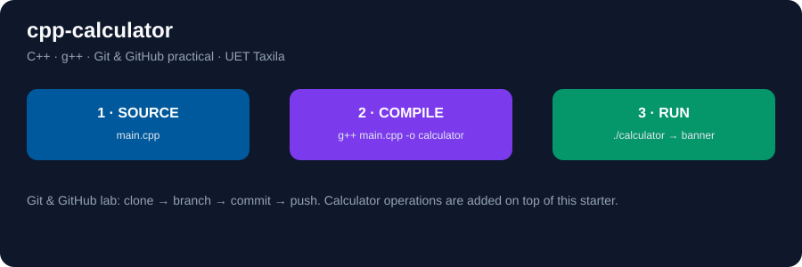
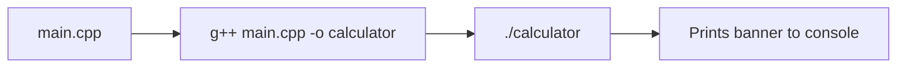

<div align="center">

# 🧮 cpp-calculator

**A minimal C++ calculator app — the Git & GitHub practical for Project Management, Department of Computer Engineering, UET Taxila.**


*C++ · g++ · Git & GitHub*

</div>

---

## 🎯 What this does

A small C++ console program and the hands-on repo for a Git & GitHub lab: clone it, branch it, commit to it, and push it. The program itself is a starter — it prints the app banner (`=== C++ Calculator App ===`) and exits. Calculator operations are added on top of this base as the lab progresses.

## 🖼️ Architecture





📸 **Screenshots:** no screenshots exist for this repo yet. A real run screenshot can be added later — save it as `docs/screenshots/run.png` and it will show here. No fake screenshots are included.

## ⚡ Quick start

Prerequisites: a C++ compiler (`g++`).

```bash
git clone https://github.com/abdullacaad/cpp-calculator
cd cpp-calculator
g++ main.cpp -o calculator
./calculator
```

Expected output:

```
=== C++ Calculator App ===
```

## 📂 Project layout

```
.
├── main.cpp            # Entry point — prints the app banner
├── README.md
├── LICENSE             # MIT
└── .gitignore          # C++ build artefacts
```

## 📄 License

MIT — see [LICENSE](LICENSE).
